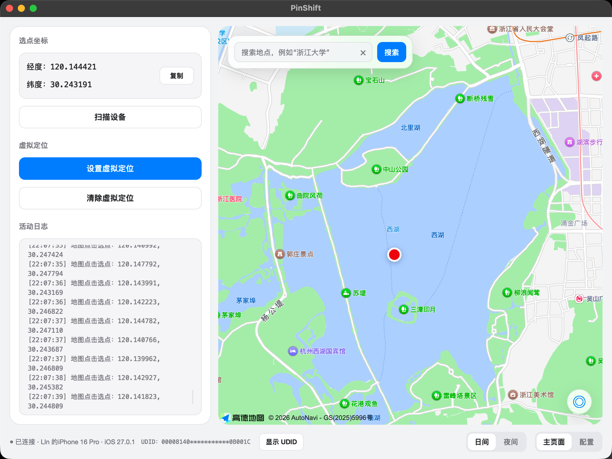
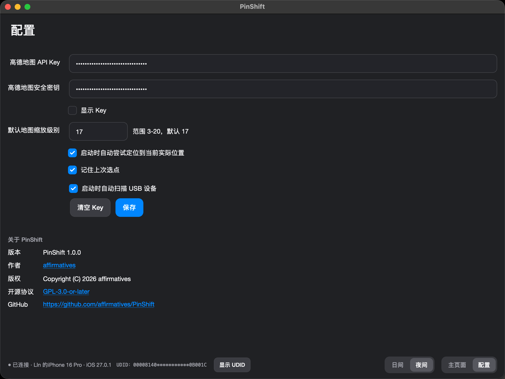

# PinShift

中文 | [English](README.en.md)

**版本：1.0.0** · **协议：GPL-3.0-or-later** · [GitHub](https://github.com/affirmatives/PinShift)

在 Mac 上选一个地图位置，通过 USB 将它设置为 iPhone 的模拟定位(虚拟定位)。

PinShift 使用 PySide6 构建桌面界面，内嵌高德地图 JavaScript API 2.0，并通过 [pymobiledevice3](https://github.com/doronz88/pymobiledevice3) 与设备通信，适合在自己的设备上开发和测试位置相关功能。

当前版本为 1.0.0，仅支持 macOS、USB 连接和单台设备，尚未建立完整的 macOS / iOS 兼容性矩阵。应用界面目前为中文；英文文档不代表已有英文界面。

## 功能

- 扫描 USB 设备，查看设备名称、iOS 版本和 UDID。
- 地图点击选点、拖动缩放、地点搜索及多结果选择。
- 显示、复制坐标，并可记住上次选点。
- 设置和清除 iPhone 模拟定位。
- 使用 macOS CoreLocation 获取 Mac 当前位置；失败时回退到杭州默认中心。
- 日间 / 夜间主题同步到地图，并保存外观偏好。
- 配置高德凭据、缩放级别和启动行为，查看版本、作者、版权、协议和 GitHub 链接。
- 界面日志、文件日志及 `.app` / `.dmg` 构建脚本。

## 应用截图

主页面



配置页



## 运行条件

| 项目    | 要求                                                               |
| ------- | ------------------------------------------------------------------ |
| 系统    | macOS；Windows / Linux 暂不支持                                    |
| Python  | 建议 3.13（当前本地环境版本）；其他版本需自行验证                  |
| 设备    | 一台通过 USB 数据线连接、已解锁并信任 Mac 的 iPhone                |
| iOS     | 依赖 pymobiledevice3 支持情况；需要时启用开发者模式                |
| 地图    | 高德 Web 端 JavaScript API Key、对应的 `securityJsCode` 及网络连接 |
| Node.js | 仅地图回归检查需要，运行应用不需要                                 |

高德apikey可通过在高德开发者平台注册获取,有一定免费额度

依赖见 [requirements.txt](requirements.txt)。依赖使用最低版本约束，尚未锁定；设备服务依赖 pymobiledevice3 的异步 API，不能据此认为所有满足版本下限的组合都已验证。

## 从源码运行

下载或克隆源码后，在项目根目录执行：

```bash
python3 -m venv .venv
source .venv/bin/activate
python -m pip install --upgrade pip
python -m pip install -r requirements.txt
python main.py
```

使用 uv 时也可以执行：

```bash
uv venv --python 3.13 .venv
source .venv/bin/activate
uv pip install -r requirements.txt
python main.py
```

已有虚拟环境时直接复用，避免覆盖本地环境。

### 配置高德地图

1. 登录[高德开放平台](https://lbs.amap.com/)，创建应用。
2. 添加 Key，服务平台选择 **Web 端 JavaScript API**。
3. 获取对应的安全密钥 `securityJsCode`。
4. 在 PinShift 的“配置”页填写 Key 和安全密钥，保存后地图会重新加载。

每位用户应配置自己的凭据，并遵守高德服务条款和配额限制。

## 使用

1. 启动应用并完成地图配置。
2. USB 连接一台 iPhone，解锁并选择“信任此电脑”；按设备要求启用开发者模式。
3. 点击“扫描设备”，确认设备信息。
4. 搜索地点并选择结果，或直接点击地图，确认经纬度。
5. 点击“设置虚拟定位”，查看操作结果。
6. 使用结束后点击“清除虚拟定位”，并在设备上确认定位已恢复。

地图选点和界面坐标使用 GCJ-02，发送到 iPhone 前转换为 WGS-84。Mac CoreLocation 坐标先从 WGS-84 转为 GCJ-02 再显示。转换采用近似算法，不适用于高精度测绘。

### iOS 17+ 与管理员授权

应用优先复用已有的 `tunneld` 连接，否则尝试建立 USB CoreDevice tunnel。遇到特定的 `utun` / `pytun` 创建错误时，会通过 macOS 系统授权窗口请求管理员权限，启动定位辅助进程。

辅助进程可能保持运行以维持 tunnel 和定位会话；关闭窗口不保证清除模拟定位，使用结束应主动点击“清除虚拟定位”。取消管理员授权会导致该次需要提权的操作失败。

自动建立 tunnel 失败时，可在已激活项目虚拟环境的另一终端运行：

```bash
pymobiledevice3 remote tunneld
```

保持进程运行，再回到应用重试。权限要求及选项取决于依赖版本，可查看 `pymobiledevice3 remote tunneld --help`。

## 配置与日志

默认数据目录：`~/Library/Application Support/PinShift/`。

| 文件                       | 内容                               |
| -------------------------- | ---------------------------------- |
| `settings.json`            | 地图凭据、选点及界面偏好           |
| `logs/pinshift.log`        | 应用日志                           |
| `logs/location_helper.log` | 管理员辅助进程日志（使用该功能时） |
| `location_helper*`         | 辅助进程的状态、命令和 PID 文件    |

可通过 `PINSHIFT_APP_SUPPORT_DIR` 环境变量指定独立数据目录，适合测试。

地图凭据以明文保存在本机配置中，地图加载和搜索会访问高德服务。日志会记录位置及部分设备信息。代码对常见 Key 字段进行了脱敏，但分享日志、截图或问题报告前仍需检查并移除凭据、UDID 和私人位置。

## 开发与检查

```text
main.py                 GUI 与定位辅助进程入口
config/                 JSON 配置读写
models/                 设置与设备模型
services/               USB 扫描、iPhone 定位、tunnel、Mac 定位
ui/                     Qt 窗口、页面、主题和组件
bridges/                Python / JavaScript Qt WebChannel 桥接
web/                    高德地图页面、样式与交互
utils/                  坐标转换、路径、日志脱敏等工具
tests/                  核心、地图及界面回归检查
assets/                 应用图标
packaging/              macOS 构建脚本
```

在项目根目录、已安装依赖的环境中运行：

```bash
PYTHONPATH=. python tests/check_core.py
node tests/check_map.cjs
PYTHONPATH=. python tests/check_ui.py
```

核心检查覆盖配置、坐标转换、错误处理、模拟 USB 扫描、依赖 API 和重复 CoreLocation 请求。地图检查模拟高德 API，无需真实 Key。界面检查需要 macOS 图形会话，会短暂打开窗口，将截图写入 `/private/tmp/pinshift-*.png`。检查使用临时配置目录。

这些检查不能替代真机验证。设备连接、设置 / 清除定位、iOS tunnel 和管理员辅助进程需在真实设备上单独验证。开发约定见 [AGENTS.md](AGENTS.md)。

## macOS 打包

在已安装依赖的虚拟环境中执行：

```bash
bash packaging/build_macos.sh
bash packaging/create_dmg.sh
```

输出为 `dist/PinShift.app` 和 `dist/PinShift.dmg`。构建脚本从 `PinShift.spec` 打包，包含 `web/`、`assets/`、许可证和版权声明，使用 `assets/PinShift.icns`，写入 1.0.0 版本、版权及定位权限说明，并进行 ad-hoc 签名及验证。脚本会覆盖对应构建产物。

当前流程未配置 Developer ID 签名和 Apple 公证，不能承诺下载后通过 Gatekeeper 检查。不同处理器架构需分别构建和测试，脚本不生成 universal binary。直接使用 `PinShift.spec` 打包不包含脚本的签名后处理，优先使用上述脚本。

## 常见问题

| 问题                            | 排查方法                                                                |
| ------------------------------- | ----------------------------------------------------------------------- |
| 地图空白或 `INVALID_USER_SCODE` | 检查 Key 服务类型、对应安全密钥、配额及网络，保存配置后重试             |
| Mac 定位失败                    | 检查系统定位权限；仍可搜索或点击选点                                    |
| 未检测到 iPhone                 | 检查数据线、解锁和信任状态；运行 `pymobiledevice3 usbmux list` 辅助排查 |
| 检测到多个设备                  | 当前只支持单设备，请仅连接一台 iPhone                                   |
| 设置或清除失败                  | 检查开发者模式、解锁、tunnel、管理员授权及依赖 API 兼容性，查看日志     |
| 打包应用异常                    | 先从源码运行以区分设备 / 依赖问题与打包问题，报告架构及系统版本         |

## 贡献与开源状态

欢迎通过 GitHub Issue 报告问题或 Pull Request 提交改进。问题报告请包含 macOS / iOS / Python / pymobiledevice3 版本、处理器架构、源码或打包运行方式、复现步骤及脱敏日志。代码提交请说明改动目的和已运行的检查，不提交虚拟环境、构建产物、个人配置或设备数据。

## 作者与许可证

- 作者：[affirmatives](https://github.com/affirmatives)。
- 项目地址：[affirmatives/PinShift](https://github.com/affirmatives/PinShift)（预设仓库地址，上传后生效）。
- 版本：**1.0.0**。
- 版权：Copyright (C) 2026 affirmatives。
- 开源协议：**GNU General Public License v3.0 or later（GPL-3.0-or-later）**。

你可以依照 GPL 第 3 版或任何后续版本使用、修改及再分发本项目。分发应用或修改版本时，须遵守 GPL，包括提供对应源码、保留许可和版权声明。软件按现状提供，不附带任何担保。

完整协议见 [LICENSE](LICENSE)，项目授权声明见 [COPYRIGHT](COPYRIGHT)，第三方组件及地图内容说明见 [THIRD_PARTY_NOTICES.md](THIRD_PARTY_NOTICES.md)。第三方内容保留其原有版权及许可，地图截图不改变高德内容的授权范围。公开分发前仍需核对实际打包组件的许可并验证发布包。

## 致谢

- [PySide6 / Qt for Python](https://doc.qt.io/qtforpython-6/)：桌面界面与 WebEngine。
- [pymobiledevice3](https://github.com/doronz88/pymobiledevice3)：iOS 设备通信和模拟定位。
- [高德开放平台](https://lbs.amap.com/)：地图与地点搜索。
- [PyObjC](https://pyobjc.readthedocs.io/)：CoreLocation 桥接。
- [PyInstaller](https://pyinstaller.org/)：应用打包。
